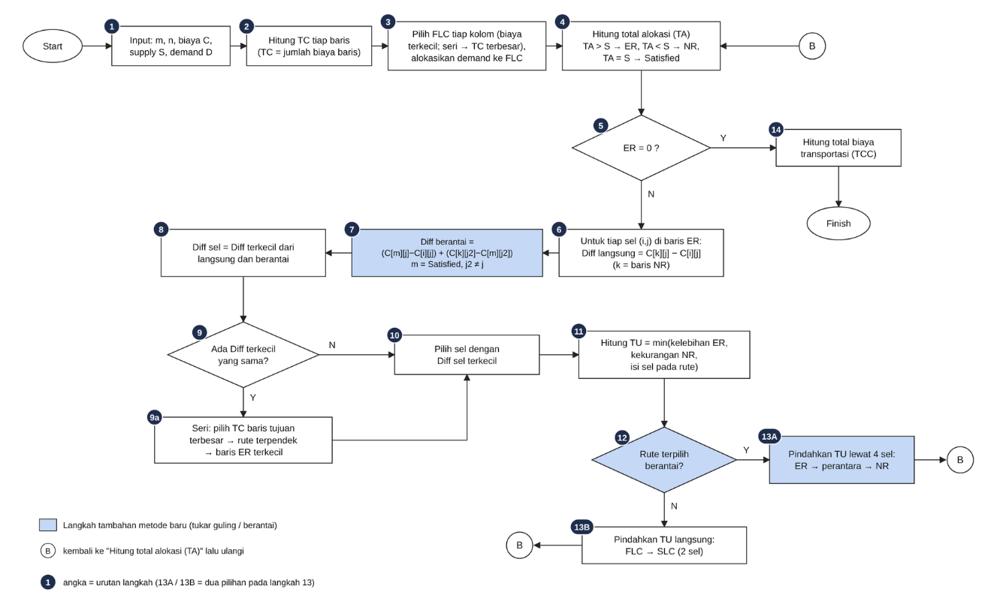
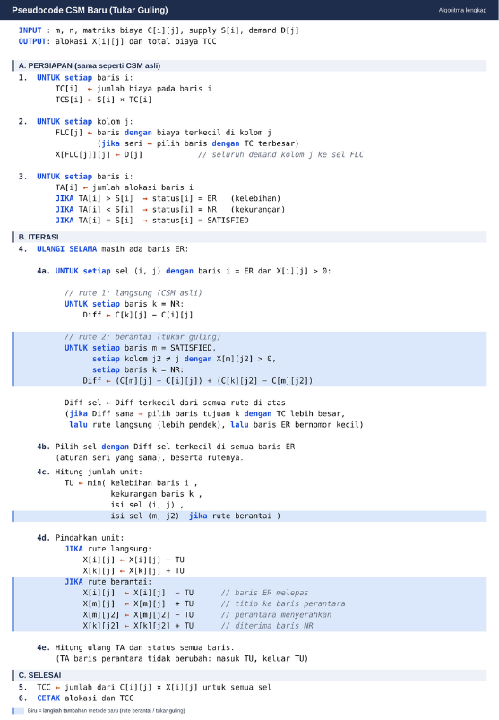
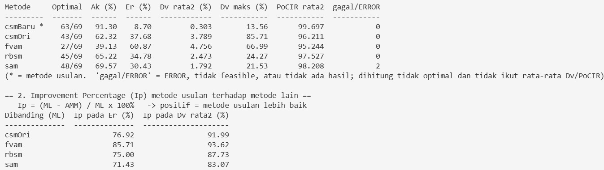
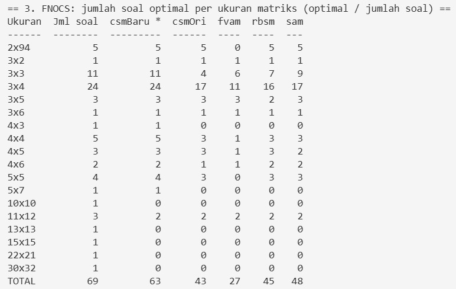

# CSM Berantai (Chain-SLC): Modifikasi Cost Supply Method untuk Masalah Transportasi

> Laporan Proyek Riset Operasi (RISOP) - Kelompok 4

| Nama | NRP |
|------|-----|
| Mochamad Kolbi Nuron | 5025231183 |
| Bradley Widjaja | 5025231036 |
| Hafidz Panji Ashari | 5025231278 |
| Izzudin Ali Akbari | 5025231313 |
| Indhira Ayu Puspita Ningrum | 5025231316 |

Repositori ini berisi implementasi **CSM (Cost Supply Method)** dengan modifikasi **rute berantai melalui satu baris perantara** (disebut *CSM Berantai* atau *Chain-SLC*) untuk mencari **Initial Basic Feasible Solution (IBFS)** pada masalah transportasi. Metode diuji pada **69 testcase standar** dan hasilnya dibandingkan dengan biaya optimal.

---

## Daftar Isi

1. [Latar Belakang dan Formulasi Masalah](#1-latar-belakang-dan-formulasi-masalah)
2. [Metode Dasar: CSM dan Metode Sekerabat](#2-metode-dasar-csm-dan-metode-sekerabat)
3. [Modifikasi: CSM Berantai](#3-modifikasi-csm-berantai)
4. [Flowchart](#4-flowchart)
5. [Pseudocode](#5-pseudocode)
6. [Implementasi Program](#6-implementasi-program)
7. [Contoh Perhitungan Langkah demi Langkah](#7-contoh-perhitungan-langkah-demi-langkah)
8. [Cara Menjalankan Program](#8-cara-menjalankan-program)
9. [Hasil Pengujian](#9-hasil-pengujian)
10. [Analisis dan Pembahasan](#10-analisis-dan-pembahasan)
11. [Kompleksitas](#11-kompleksitas)
12. [Kesimpulan](#12-kesimpulan)
13. [Struktur Repositori](#13-struktur-repositori)
14. [Referensi](#14-referensi)

---

## 1. Latar Belakang dan Formulasi Masalah

Masalah transportasi (*Transportation Problem*, TP) adalah masalah menentukan jumlah barang yang dikirim dari $m$ sumber ke $n$ tujuan dengan **total biaya minimum**, tanpa melanggar kapasitas supply tiap sumber dan kebutuhan demand tiap tujuan.

Misalkan $c_{ij}$ adalah biaya per unit dari sumber $i$ ke tujuan $j$, $x_{ij}$ jumlah unit yang dikirim, $s_i$ supply, dan $d_j$ demand. Maka:

$$
\min Z = \sum_{i=1}^{m}\sum_{j=1}^{n} c_{ij}\,x_{ij}
$$

dengan kendala:

$$
\sum_{j=1}^{n} x_{ij} = s_i \;\; \forall i, \qquad
\sum_{i=1}^{m} x_{ij} = d_j \;\; \forall j, \qquad
x_{ij} \ge 0
$$

Solusi awal (IBFS) biasanya dicari dengan metode heuristik seperti VAM, SAM, RBSM, dan CSM, lalu dapat diperbaiki dengan MODI/stepping stone. Kualitas IBFS menentukan seberapa dekat solusi awal dengan optimum. Karena itu pada proyek ini kami mengembangkan CSM supaya IBFS yang dihasilkan lebih mendekati optimum **tanpa** menambahkan tahap MODI.

> **Asumsi:** pada semua testcase, total supply sama dengan total demand (masalah seimbang).

---

## 2. Metode Dasar: CSM dan Metode Sekerabat

CSM, SSM, dan RBSM berasal dari satu keluarga metode yang sama. Semuanya diawali dengan **mengalokasikan demand tiap kolom ke sel termurah (FLC)**. Alokasi ini memenuhi demand tetapi belum tentu memenuhi supply, sehingga ada baris yang kelebihan alokasi (*Excess Row*, ER) dan ada yang kekurangan (*Need Supply*, NR). Tahap berikutnya adalah **memindahkan unit dari baris ER ke baris NR** dengan tambahan biaya paling kecil.

### 2.1 Istilah

| Istilah | Arti |
|---|---|
| **TC** (*Total Cost*) | Jumlah biaya semua sel pada satu baris: $TC_i = \sum_j c_{ij}$ |
| **TCS** | $TCS_i = TC_i \times s_i$ |
| **FLC** (*First Lowest Cost*) | Sel dengan biaya terkecil pada suatu kolom (alokasi awal) |
| **SLC** (*Second Lowest Cost*) | Sel tujuan pemindahan unit pada kolom yang sama, yaitu baris NR |
| **TA** (*Total Allocation*) | Jumlah alokasi satu baris: $TA_i = \sum_j x_{ij}$ |
| **ER** (*Excess Row*) | Baris dengan $TA_i > s_i$ |
| **NR** (*Need Supply Row*) | Baris dengan $TA_i < s_i$ |
| **Satisfied** | Baris dengan $TA_i = s_i$ |
| **Diff** | Selisih biaya: $\text{Diff} = c_{SLC} - c_{FLC}$, yaitu tambahan biaya per unit bila unit dipindah |
| **SDiff** | *Smallest Diff*, yaitu Diff terkecil |
| **TU** (*Total Unit*) | Jumlah unit yang dipindahkan |
| **TUC** | $TUC = TU \times \text{cost}$ |

### 2.2 Langkah CSM asli (standar dosen)

Berikut langkah CSM sesuai dokumen acuan dosen (*perbedaan SSM, CSM, RBSM dan Modif SSM*):

1. Tambahkan **2 kolom baru**: `TC` (total cost baris) dan `TCS = TC x supply`.
2. **Untuk tiap kolom**:
   1. Tentukan **FLC** (sel biaya terkecil di kolom). Jika seri, pilih FLC dengan **TC terbesar**.
   2. Alokasikan seluruh demand kolom tersebut pada FLC.
3. **Untuk tiap baris**: hitung **TA**. Jika $TA > S$, baris tersebut adalah **baris ER**.
4. **Untuk tiap sel pada baris ER**:
   1. Tentukan **SLC**. Jika seri, pilih SLC dengan **TC terbesar**.
   2. Hitung $\text{Diff} = SLC - FLC$.
5. Tentukan **SDiff** (Diff terkecil). Jika seri, pilih SDiff dengan **TUC terkecil pada SLC**, dengan TU adalah unit yang akan dipindah dari FLC ke SLC.
6. Pindahkan unit dari FLC ke SLC. Tentukan apakah yang dipuaskan baris FLC atau baris SLC:
   - Jika supply FLC $\neq$ supply SLC: puaskan baris dengan **TCS terbesar**.
   - Jika supply FLC $=$ supply SLC: puaskan **baris FLC**.
7. Ulangi langkah 3 sampai 6 sampai tidak ada baris ER.

### 2.3 Perbandingan SSM, Modif SSM, CSM, dan RBSM

Perbedaan keempat metode menurut dokumen acuan dosen:

| Aspek | SSM | Modif SSM (Danno) | CSM | RBSM |
|---|---|---|---|---|
| **Kolom tambahan** | - | 1 kolom: `AS` = average cost x supply | 2 kolom: `TC` dan `TCS = TC x supply` | 1 kolom: `TC` |
| **Tie FLC** | Indeks terkecil | AS terbesar | TC terbesar | TC terbesar |
| **Tie SLC** | Indeks terkecil | AS terbesar | TC terbesar | TC terbesar |
| **Diff** | $SLC - FLC$ | $SLC - FLC$ | $SLC - FLC$ | $SLC - FLC$ |
| **Tie SDiff** | Pilih SDiff dengan unit terbesar pada FLC | Pilih SDiff dengan unit terbesar pada FLC | Pilih SDiff dengan TUC terkecil pada SLC | Pilih SDiff dengan TUC terkecil pada SLC |
| **Baris yang dipuaskan, supply FLC $\neq$ SLC** | ER = 1: baris supply terkecil. ER $\ge$ 2: baris supply terbesar | ER = 1: baris AS terkecil. ER $\ge$ 2: baris AS terbesar | Baris TCS terbesar | Baris dengan (cost x supply) terbesar |
| **Baris yang dipuaskan, supply FLC $=$ SLC** | Baris FLC | Baris FLC | Baris FLC | Baris FLC |

Pada semua metode di atas, unit hanya dapat dipindah **langsung** dari baris ER ke baris NR (satu langkah). Keterbatasan inilah yang menjadi dasar modifikasi kami.

---

## 3. Modifikasi: CSM Berantai

### 3.1 Ide utama

Pada CSM asli, tambahan biaya memindahkan satu unit dari sel $(i,j)$ di baris ER ke baris NR $k$ pada kolom yang sama adalah:

$$
\text{Diff langsung} = c_{kj} - c_{ij}
$$

Kadang sel $(k,j)$ sangat mahal sehingga Diff langsung besar, padahal ada jalur tidak langsung yang lebih murah: unit dititipkan dulu ke **baris perantara** $m$ yang sudah *Satisfied*. Baris $m$ lalu melepaskan jumlah unit yang sama pada kolom lain $j_2$, dan unit itu diterima baris NR $k$ pada kolom $j_2$.

$$
\text{Diff berantai} = (c_{mj} - c_{ij}) + (c_{kj_2} - c_{mj_2}), \qquad m \in \text{Satisfied},\; j_2 \neq j,\; x_{mj_2} > 0
$$

Diff sel yang dipakai adalah nilai yang lebih kecil dari keduanya:

$$
\text{Diff sel} = \min(\text{Diff langsung},\ \text{Diff berantai})
$$

### 3.2 Pemindahan unit berantai

Jika rute berantai terpilih, **empat sel** diperbarui sekaligus dengan jumlah $TU$:

| Sel | Perubahan | Arti |
|---|---|---|
| $x_{ij}$ | $-TU$ | Baris ER melepas unit |
| $x_{mj}$ | $+TU$ | Baris perantara menerima titipan |
| $x_{mj_2}$ | $-TU$ | Baris perantara menyerahkan unit di kolom lain |
| $x_{kj_2}$ | $+TU$ | Baris NR menerima unit |

Dengan jumlah:

$$
TU = \min\big(\text{kelebihan baris } i,\ \text{kekurangan baris } k,\ x_{ij},\ x_{mj_2}\big)
$$

**Mengapa tetap layak?** Pada kolom $j$ dan $j_2$, unit yang keluar sama dengan yang masuk ($-TU + TU$), sehingga **demand tidak berubah**. Pada baris perantara $m$, unit yang masuk sama dengan yang keluar, sehingga **TA baris $m$ tidak berubah** dan statusnya tetap *Satisfied*. Perubahan total biaya adalah $\text{Diff} \times TU$.

### 3.3 Yang berubah dan yang tetap

| Komponen | CSM asli | CSM Berantai |
|---|---|---|
| TC, TCS, FLC per kolom (alokasi awal) | Ya | Sama |
| Status ER / NR / Satisfied | Ya | Sama |
| Memilih Diff sel terkecil | Ya | Sama |
| Rute pemindahan | Langsung ER $\to$ NR | Langsung **atau** ER $\to$ perantara $\to$ NR |
| Perhitungan Diff | $c_{SLC} - c_{FLC}$ | $\min$(langsung, berantai) |
| Tie-break | TC SLC terbesar | Diff sama: baris tujuan dengan TC lebih besar, lalu rute lebih pendek, lalu baris ER bernomor kecil |

Modifikasi ini **tidak** memakai MODI dan **tidak** memakai *look-ahead* atau CSM bersarang. Kerangka CSM tetap dipertahankan dan hanya cara menghitung Diff yang diperluas.

### 3.4 Parameter `MAXHOP`

Kode memiliki konstanta `MAXHOP` yang mengatur panjang rute maksimal:

| `MAXHOP` | Perilaku |
|---|---|
| 1 | Hanya rute langsung. Setara CSM asli (dipakai sebagai pembanding) |
| **2** | **Satu** baris perantara (**default**, metode yang kami usulkan, mudah dihitung manual) |
| 3 | Dua baris perantara (lebih akurat, hitung manual lebih panjang) |

---

## 4. Flowchart



Kotak berwarna biru adalah langkah tambahan dibanding CSM asli (rute berantai). Ringkasan langkah:

1. Input $m$, $n$, matriks biaya $C$, supply $S$, demand $D$.
2. Hitung TC tiap baris.
3. Pilih FLC tiap kolom (biaya terkecil; seri: TC terbesar), alokasikan demand ke FLC.
4. Hitung TA tiap baris: $TA > S$ adalah ER, $TA < S$ adalah NR, $TA = S$ adalah Satisfied.
5. Jika tidak ada ER, **hitung TCC** (langkah 14) dan selesai.
6. Untuk tiap sel $(i,j)$ di baris ER hitung **Diff langsung** $= C[k][j] - C[i][j]$.
7. Hitung **Diff berantai** $= (C[m][j]-C[i][j]) + (C[k][j_2]-C[m][j_2])$ dengan $m$ Satisfied, $j_2 \neq j$. *(langkah baru)*
8. Diff sel adalah Diff terkecil dari rute langsung dan berantai.
9. Jika ada Diff terkecil yang sama, selesaikan seri (9a): TC baris tujuan terbesar, lalu rute terpendek, lalu baris ER terkecil.
10. Pilih sel dengan Diff terkecil.
11. Hitung $TU$.
12. Apakah rute terpilih berantai? *(keputusan baru)*
13. **13A**: pindahkan $TU$ lewat 4 sel (ER $\to$ perantara $\to$ NR). **13B**: pindahkan $TU$ langsung (2 sel). Kembali ke langkah 4.

---

## 5. Pseudocode



Versi teks:

```text
INPUT  : matriks biaya C[i][j], supply S[i], demand D[j]
OUTPUT : alokasi X[i][j] dan total biaya TCC

A. PERSIAPAN (sama seperti CSM asli)
1. UNTUK setiap baris i:
       TC[i]  <- jumlah biaya pada baris i
       TCS[i] <- S[i] x TC[i]
2. UNTUK setiap kolom j:
       FLC[j] <- baris dengan biaya terkecil di kolom j
                 (jika seri -> pilih baris dengan TC terbesar)
       X[FLC[j]][j] <- D[j]                  // seluruh demand kolom j ke sel FLC
3. UNTUK setiap baris i:
       TA[i] <- jumlah alokasi baris i
       JIKA TA[i] > S[i]  -> status[i] = ER   (kelebihan)
       JIKA TA[i] < S[i]  -> status[i] = NR   (kekurangan)
       JIKA TA[i] = S[i]  -> status[i] = SATISFIED

B. ITERASI
4. ULANGI SELAMA masih ada baris ER:
   4a. UNTUK setiap sel (i, j) dengan baris i = ER dan X[i][j] > 0:
         // rute 1: langsung (CSM asli)
         UNTUK setiap baris k = NR:
             Diff <- C[k][j] - C[i][j]
         // rute 2: berantai (tukar guling)  <-- LANGKAH BARU
         UNTUK setiap baris m = SATISFIED,
             setiap kolom j2 != j dengan X[m][j2] > 0,
             setiap baris k = NR:
                 Diff <- (C[m][j] - C[i][j]) + (C[k][j2] - C[m][j2])
         Diff sel <- Diff terkecil dari semua rute di atas
         (jika Diff sama -> pilih baris tujuan k dengan TC lebih besar,
          lalu rute langsung (lebih pendek), lalu baris ER bernomor kecil)
   4b. Pilih sel dengan Diff sel terkecil di semua baris ER (beserta rutenya).
   4c. Hitung jumlah unit:
         TU <- min( kelebihan baris i, kekurangan baris k, isi sel (i,j),
                    isi sel (m,j2) jika rute berantai )
   4d. Pindahkan unit:
         JIKA rute langsung:
             X[i][j] <- X[i][j] - TU
             X[k][j] <- X[k][j] + TU
         JIKA rute berantai:
             X[i][j]  <- X[i][j]  - TU      // baris ER melepas
             X[m][j]  <- X[m][j]  + TU      // titip ke baris perantara
             X[m][j2] <- X[m][j2] - TU      // perantara menyerahkan
             X[k][j2] <- X[k][j2] + TU      // diterima baris NR
   4e. Hitung ulang TA dan status semua baris.
       (TA baris perantara tidak berubah: masuk TU, keluar TU)

C. SELESAI
5. TCC <- jumlah dari C[i][j] x X[i][j] untuk semua sel
6. CETAK alokasi dan TCC
```

---

## 6. Implementasi Program

Implementasi ada pada [`CSMPerantara.c`](CSMPerantara.c) (bahasa C). Komponen utamanya:

| Fungsi | Peran |
|---|---|
| `compute()` | Membaca input, menghitung TC dan TCS, menjalankan alokasi FLC, lalu loop iterasi sampai semua baris Satisfied |
| `minimumCell()` | Menentukan FLC tiap kolom (seri: TC terbesar) dan mengalokasikan demand |
| `updateStatus()` | Menentukan status baris: 1 = Satisfied, 2 = Need Supply, 3 = Excess Row |
| `chooseMove()` | Untuk tiap sel ER menghitung Diff langsung dan Diff berantai, lalu memilih rute terbaik dan mencetak tabelnya |
| `dfs()` | Pencarian rute dari baris ER sampai baris NR dengan maksimal `MAXHOP` langkah. Hop pertama dikunci pada kolom $j$ sel ER, hop berikutnya hanya lewat baris Satisfied |
| `record()` | Menghitung jumlah unit $TU$ suatu rute dan menyimpannya bila lebih baik |
| `better()` | Aturan pembanding rute: Diff terkecil, TC baris tujuan terbesar, rute terpendek, baris ER terkecil |
| `runFolder()` | Menjalankan semua file `.txt` dalam satu folder dan menulis hasil serta ringkasan ke `csmBaru.txt` |

Potongan inti penghitungan Diff berantai (hop berikutnya lewat baris Satisfied, kolom boleh berbeda):

```c
/* dfs(): dari baris r, coba semua kolom j berisi unit, ke semua baris k yang belum dipakai */
for (j = 0; j < col; j++) {
    if (forcedCol >= 0 && j != forcedCol) continue;   /* hop pertama: kolom sel ER */
    if (!supply[r][j]) continue;                      /* harus ada unit untuk dipindah */
    for (k = 0; k < row; k++) {
        if (used & (1 << k)) continue;
        /* langkah ini: unit di (r,j) pindah ke (k,j) -> biaya c[k][j] - c[r][j] */
        dfs(k, cost + matrix[k][j] - matrix[r][j], used | (1 << k), src, -1);
    }
}
```

Jika baris tujuan berstatus NR, rute dicatat. Jika berstatus Satisfied dan hop belum mencapai `MAXHOP`, pencarian dilanjutkan. Total Diff rute adalah penjumlahan biaya tiap hop, sehingga untuk rute dua hop hasilnya persis $(c_{mj}-c_{ij}) + (c_{kj_2}-c_{mj_2})$.

### Kesesuaian dengan standar dosen

Kerangka (TC, TCS, FLC, ER/NR/Satisfied, Diff, SDiff, TU) mengikuti CSM standar. Ada beberapa penyederhanaan yang perlu dicatat:

- Pada kode, SLC tidak dipilih per kolom lebih dulu, tetapi seluruh baris NR dievaluasi dan dipilih yang Diff-nya terkecil. Pada kasus yang SLC-nya hanya satu, hasilnya sama.
- Aturan seri mengikuti flowchart kami (TC baris tujuan terbesar, rute terpendek, baris ER terkecil). Aturan "TUC terkecil" dan "puaskan baris TCS terbesar" dari dokumen dosen tidak diimplementasikan secara eksplisit.
- Oleh karena itu hasil `MAXHOP=1` pada kode (46/69 optimal) tidak persis sama dengan `csmOri` pada program benchmark kelompok (43/69), tetapi masih sekelas.

---

## 7. Contoh Perhitungan Langkah demi Langkah

Contoh memakai testcase [`G3_P03.txt`](69/G3_P03.txt) berukuran 3x4, yang rute berantainya terpakai dan menghasilkan solusi lebih baik dari CSM asli.

**Data:**

| | D1 | D2 | D3 | D4 | Supply | TC |
|---|---:|---:|---:|---:|---:|---:|
| **S1** | 6 | 3 | 5 | 4 | 22 | 18 |
| **S2** | 5 | 9 | 2 | 7 | 15 | 23 |
| **S3** | 5 | 7 | 8 | 6 | 8 | 26 |
| **Demand** | 7 | 12 | 17 | 9 | 45 | |

**Langkah 1-3: alokasi awal ke FLC tiap kolom.**
FLC D1 = S3 (5, seri dengan S2; TC S3=26 > 23), D2 = S1 (3), D3 = S2 (2), D4 = S1 (4).
Alokasi: $x_{31}=7,\ x_{12}=12,\ x_{23}=17,\ x_{14}=9$.

| | D1 | D2 | D3 | D4 | TA | Supply | Status |
|---|---:|---:|---:|---:|---:|---:|---|
| S1 | 0 | 12 | 0 | 9 | 21 | 22 | NR |
| S2 | 0 | 0 | 17 | 0 | 17 | 15 | **ER** (lebih 2) |
| S3 | 7 | 0 | 0 | 0 | 7 | 8 | NR |

**Iterasi 1.** Satu-satunya sel ER adalah $(S2, D3)$ dengan biaya 2. Pilihan rute langsung:
- ke S1: $\text{Diff} = c_{13} - c_{23} = 5 - 2 = 3$
- ke S3: $\text{Diff} = c_{33} - c_{23} = 8 - 2 = 6$

Belum ada baris Satisfied, jadi tidak ada rute berantai. Diff terkecil = 3 (ke S1). $TU = \min(2, 1, 17) = 1$. Setelah dipindah, S1 menjadi Satisfied dengan $x_{13}=1$. Biaya bertambah $3 \times 1 = 3$.

**Iterasi 2.** Sekarang S2 masih ER (lebih 1), S3 masih NR (kurang 1), dan S1 sudah Satisfied sehingga boleh menjadi perantara. Sel ER: $(S2, D3)$.

| Rute | Perhitungan | Diff |
|---|---|---:|
| Langsung S2 $\to$ S3 pada D3 | $c_{33}-c_{23} = 8-2$ | 6 |
| **Berantai** S2 $\to$ S1 (D3), lalu S1 $\to$ S3 (D4) | $(c_{13}-c_{23}) + (c_{34}-c_{14}) = (5-2) + (6-4)$ | **5** |

Rute berantai lebih murah (5 < 6), sehingga dipilih. $TU = \min(1, 1, x_{23}=16, x_{14}=9) = 1$. Empat sel berubah:
$x_{23}-1,\ x_{13}+1,\ x_{14}-1,\ x_{34}+1$.

**Hasil akhir:**

| | D1 | D2 | D3 | D4 | TA = Supply |
|---|---:|---:|---:|---:|---:|
| S1 | 0 | 12 | 2 | 8 | 22 |
| S2 | 0 | 0 | 15 | 0 | 15 |
| S3 | 7 | 0 | 0 | 1 | 8 |

$$
TCC = (12\times3) + (2\times5) + (8\times4) + (15\times2) + (7\times5) + (1\times6) = 149
$$

Nilai ini sama dengan solusi optimal (149). **CSM asli** pada iterasi 2 terpaksa memakai rute langsung S2 $\to$ S3 di D3 (Diff 6) dan berakhir pada **TCC = 150**.

Jejak eksekusi lengkap (tabel TA, status, dan Diff tiap sel) dapat dihasilkan dengan menjalankan program, lihat bagian berikutnya.

---

## 8. Cara Menjalankan Program

### 8.1 Kompilasi

Dibutuhkan GCC (MinGW pada Windows).

```bash
# CSM Berantai, 1 baris perantara (default, MAXHOP=2)
gcc -O2 -o csm_berantai CSMPerantara.c

# CSM asli sebagai pembanding (hanya rute langsung)
gcc -O2 -DMAXHOP=1 -o csm_asli CSMPerantara.c

# Dua baris perantara
gcc -O2 -DMAXHOP=3 -o csm_hop3 CSMPerantara.c
```

### 8.2 Menjalankan

```bash
./csm_berantai
```

Menu program:

```text
1 = Default (input.txt)
2 = Custom (ketik nama file)
3 = Semua file .txt dalam satu folder (hasil -> csmBaru.txt)
4 = Exit
```

Untuk menjalankan seluruh 69 testcase sekaligus, pilih `3`, lalu ketik nama folder, misalnya `69`. Hasil lengkap semua iterasi dan ringkasan TCC tiap file ditulis ke `csmBaru.txt`.

> **Penting:** nama folder/file **tidak boleh mengandung spasi** dan jangan diberi tanda kutip. Jika jalur mengandung spasi, program tidak membaca input dengan benar. Jalankan dari folder yang berisi folder `69`.

### 8.3 Format input

```text
m n

c[1][1] c[1][2] ... c[1][n]
...
c[m][1] c[m][2] ... c[m][n]

s[1] s[2] ... s[m]

d[1] d[2] ... d[n]

(opsional) nilai TCC referensi
```

`m` adalah jumlah sumber, `n` jumlah tujuan, `c` matriks biaya, `s` supply, dan `d` demand. Angka terakhir pada file adalah nilai referensi dan **tidak dibaca** oleh program.

Contoh `G1_N01.txt`:

```text
3 3

32 40 120
60 68 104
200 80 60

20 30 45
30 35 30

5600
```

### 8.4 Format output

Pada tiap iterasi program mencetak tabel biaya dan alokasi (`biaya [alokasi]`), supply, TC, TCS, TA, dan status tiap baris. Baris `STEP 4` memperlihatkan Diff langsung dan Diff berantai tiap sel ER. Baris `STEP 5` dan `STEP 6` menyebut sel terpilih, rute, dan jumlah unit. Pada akhir, program mencetak `TCC`.

---

## 9. Hasil Pengujian

### 9.1 Metodologi

- **Dataset:** 69 testcase pada folder [`69/`](69), dengan ukuran 3x2 sampai 30x32, serta 2x94 pada kelompok G9.
- **Pembanding:** nilai pada baris terakhir tiap file, yaitu biaya optimal. Khusus `G6_N04`, angka pada file (555) tidak sesuai matriks. Nilai optimal yang benar adalah **1580**, sesuai catatan pada repositori [Risop-RBS-CS](https://github.com/aelraffa/Risop-RBS-CS), dan nilai ini yang kami pakai.
- **Metode yang dibandingkan:** CSM Berantai (metode usulan, `csmBaru`), CSM asli (`csmOri`), Fractional VAM (`fvam`), RBSM (`rbsm`), dan SAM (`sam`). Seluruhnya dijalankan pada 69 testcase yang sama.
- **Ablasi:** `CSMPerantara.c` juga dikompilasi dengan `MAXHOP=1`, `MAXHOP=2`, dan `MAXHOP=3` untuk melihat pengaruh panjang rute (bagian 9.5).
- **Metrik:**

| Singkatan | Arti |
|---|---|
| Optimal | Jumlah testcase yang biayanya sama dengan biaya optimal |
| Ak (%) | Akurasi: Optimal / 69 x 100% |
| Er (%) | Tingkat gagal mencapai optimal: 100% - Ak |
| Dv rata2 (%) | Deviasi (gap) rata-rata terhadap optimal |
| Dv maks (%) | Deviasi terbesar pada satu testcase |
| PoCIR rata2 | Pada output program bernilai 100 dikurangi Dv rata2 (mis. 100 - 0,303 = 99,697) |
| gagal/ERROR | Hasil ERROR, tidak feasible, atau tidak ada hasil. Dihitung tidak optimal dan tidak ikut rata-rata Dv dan PoCIR |
| Ip | *Improvement Percentage*: $Ip = \frac{ML - AMM}{ML} \times 100\%$, dengan $ML$ nilai metode pembanding dan $AMM$ nilai metode usulan. Positif berarti metode usulan lebih baik |
| FNOCS | Jumlah soal optimal per ukuran matriks |

$$
\text{Dv}(\%) = \frac{Z_{\text{metode}} - Z^*}{Z^*} \times 100\%
$$

dengan $Z^*$ adalah biaya optimal. Solusi dikatakan optimal bila $Z_{\text{metode}} = Z^*$.

### 9.2 Perbandingan lima metode

Keluaran program benchmark kelompok:



| Metode | Optimal | Ak (%) | Er (%) | Dv rata2 (%) | Dv maks (%) | PoCIR rata2 | gagal/ERROR |
|---|---:|---:|---:|---:|---:|---:|---:|
| **csmBaru (usulan)** | **63/69** | **91,30** | **8,70** | **0,303** | **13,56** | **99,697** | 0 |
| csmOri | 43/69 | 62,32 | 37,68 | 3,789 | 85,71 | 96,211 | 0 |
| fvam | 27/69 | 39,13 | 60,87 | 4,756 | 66,99 | 95,244 | 0 |
| rbsm | 45/69 | 65,22 | 34,78 | 2,473 | 24,27 | 97,527 | 0 |
| sam | 48/69 | 69,57 | 30,43 | 1,792 | 21,53 | 98,208 | 2 |

`csmOri` adalah implementasi CSM asli pada program benchmark kelompok. Hasilnya (43/69) berbeda dari `MAXHOP=1` pada bagian 9.5 (46/69) karena keduanya program yang berbeda. Kemungkinan penyebabnya adalah aturan seri, tetapi hal ini belum kami periksa.

### 9.3 Improvement Percentage (Ip)

Ip menyatakan seberapa besar metode usulan memperbaiki metode lain:

| Dibanding (ML) | Ip pada Er (%) | Ip pada Dv rata2 (%) |
|---|---:|---:|
| csmOri | 76,92 | 91,99 |
| fvam | 85,71 | 93,62 |
| rbsm | 75,00 | 87,73 |
| sam | 71,43 | 83,07 |

Sebagai contoh, terhadap `csmOri`: Ip pada Er $= (37{,}68 - 8{,}70)/37{,}68 = 76{,}92\%$. Seluruh nilai Ip positif, artinya metode usulan lebih baik pada kedua ukuran terhadap keempat metode lain.

### 9.4 Jumlah soal optimal per ukuran matriks (FNOCS)



| Ukuran | Jml soal | csmBaru | csmOri | fvam | rbsm | sam |
|---|---:|---:|---:|---:|---:|---:|
| 2x94 | 5 | 5 | 5 | 0 | 5 | 5 |
| 3x2 | 1 | 1 | 1 | 1 | 1 | 1 |
| 3x3 | 11 | 11 | 4 | 6 | 7 | 9 |
| 3x4 | 24 | 24 | 17 | 11 | 16 | 17 |
| 3x5 | 3 | 3 | 3 | 3 | 2 | 3 |
| 3x6 | 1 | 1 | 1 | 1 | 1 | 1 |
| 4x3 | 1 | 1 | 0 | 0 | 0 | 0 |
| 4x4 | 5 | 5 | 3 | 1 | 3 | 3 |
| 4x5 | 3 | 3 | 3 | 1 | 3 | 2 |
| 4x6 | 2 | 2 | 1 | 1 | 2 | 2 |
| 5x5 | 4 | 4 | 3 | 0 | 3 | 3 |
| 5x7 | 1 | 1 | 0 | 0 | 0 | 0 |
| 10x10 | 1 | 0 | 0 | 0 | 0 | 0 |
| 11x12 | 3 | 2 | 2 | 2 | 2 | 2 |
| 13x13 | 1 | 0 | 0 | 0 | 0 | 0 |
| 15x15 | 1 | 0 | 0 | 0 | 0 | 0 |
| 22x21 | 1 | 0 | 0 | 0 | 0 | 0 |
| 30x32 | 1 | 0 | 0 | 0 | 0 | 0 |
| **Total** | **69** | **63** | **43** | **27** | **45** | **48** |

Metode usulan optimal pada seluruh soal sampai ukuran 5x7 (**61 dari 61 soal**). Soal yang tidak optimal hanya pada matriks besar (10x10 ke atas): 6 dari 8 soal berukuran itu.

### 9.5 Pengaruh rute berantai dan `MAXHOP` (ablasi)

Bagian ini membandingkan tiga varian dari **program yang sama** (`CSMPerantara.c`) dengan mengubah `MAXHOP`.

| Varian | Solusi optimal | Akurasi | Rata-rata gap | Gap maksimum |
|---|---:|---:|---:|---:|
| Rute langsung saja (`MAXHOP=1`) | 46 / 69 | 66,67% | 2,25% | 21,44% |
| **CSM Berantai (`MAXHOP=2`)** | **63 / 69** | **91,30%** | **0,30%** | **13,56%** |
| CSM Berantai 2 perantara (`MAXHOP=3`) | 66 / 69 | 95,65% | 0,09% | 3,73% |

Perbandingan `MAXHOP=2` terhadap `MAXHOP=1` pada 69 testcase:

| Hasil | Jumlah testcase |
|---|---:|
| Berantai lebih murah | 23 |
| Sama | 46 |
| Berantai lebih mahal | 0 |

Semua solusi yang dihasilkan layak (69/69, tidak ada yang `ERROR`). Dari 23 testcase yang membaik, 17 di antaranya menjadi optimal.

### 9.6 Hasil per testcase (MAXHOP=1 vs MAXHOP=2)

Tanda `*` berarti biaya sama dengan optimal. Kolom "Optimal" adalah nilai referensi. `MAXHOP=1` adalah program yang sama dengan rute langsung saja, `MAXHOP=2` adalah CSM Berantai.

| No | Testcase | Ukuran | Optimal | MAXHOP=1 | MAXHOP=2 (Berantai) | Keterangan |
|:--:|:---|:---:|---:|---:|---:|:---|
| 1 | `G1_N01` | 3x3
 | 5600 | 5600* | 5600* | Sama (keduanya optimal) |
| 2 | `G1_N12` | 3x3
 | 425 | 425* | 425* | Sama (keduanya optimal) |
| 3 | `G1_N21` | 3x3
 | 4205 | 4205* | 4205* | Sama (keduanya optimal) |
| 4 | `G1_P07` | 3x3
 | 291 | 291* | 291* | Sama (keduanya optimal) |
| 5 | `G1_P11` | 3x2 | 600 | 600* | 600* | Sama (keduanya optimal) |
| 6 | `G1_P17` | 3x3
 | 475 | 490 | 475* | **Modifikasi optimal**, CSM asli +3,16% |
| 7 | `G1_P18` | 3x3
 | 555 | 555* | 555* | Sama (keduanya optimal) |
| 8 | `G1_P19` | 3x3
 | 1390 | 1450 | 1390* | **Modifikasi optimal**, CSM asli +4,32% |
| 9 | `G2_N02` | 3x4
 | 28 | 28* | 28* | Sama (keduanya optimal) |
| 10 | `G2_N14` | 3x4
 | 920 | 920* | 920* | Sama (keduanya optimal) |
| 11 | `G2_N15` | 3x4
 | 156 | 156* | 156* | Sama (keduanya optimal) |
| 12 | `G2_N22` | 3x4
 | 12075 | 12075* | 12075* | Sama (keduanya optimal) |
| 13 | `G2_N23` | 3x4
 | 23 | 23* | 23* | Sama (keduanya optimal) |
| 14 | `G2_P12` | 3x4 | 180 | 180* | 180* | Sama (keduanya optimal) |
| 15 | `G3_N31` | 3x4
 | 1480 | 1480* | 1480* | Sama (keduanya optimal) |
| 16 | `G3_N33` | 3x3 | 1250 | 1310 | 1250* | **Modifikasi optimal**, CSM asli +4,80% |
| 17 | `G3_N35` | 3x4
 | 280 | 280* | 280* | Sama (keduanya optimal) |
| 18 | `G3_P02` | 3x4
 | 2850 | 2900 | 2850* | **Modifikasi optimal**, CSM asli +1,75% |
| 19 | `G3_P03` | 3x4
 | 149 | 150 | 149* | **Modifikasi optimal**, CSM asli +0,67% |
| 20 | `G3_P04` | 3x4
 | 450 | 450* | 450* | Sama (keduanya optimal) |
| 21 | `G3_P09` | 3x3
 | 845 | 845* | 845* | Sama (keduanya optimal) |
| 22 | `G3_P13` | 3x4 | 3210 | 3450 | 3210* | **Modifikasi optimal**, CSM asli +7,48% |
| 23 | `G3_P20` | 3x4 | 3320 | 3320* | 3320* | Sama (keduanya optimal) |
| 24 | `G3_S07` | 3x4
 | 305 | 305* | 305* | Sama (keduanya optimal) |
| 25 | `G4_N07` | 3x4
 | 1160 | 1160* | 1160* | Sama (keduanya optimal) |
| 26 | `G4_N10` | 3x4
 | 910 | 910* | 910* | Sama (keduanya optimal) |
| 27 | `G4_N11` | 3x4
 | 2460 | 2460* | 2460* | Sama (keduanya optimal) |
| 28 | `G4_N16` | 3x4
 | 1510 | 1510* | 1510* | Sama (keduanya optimal) |
| 29 | `G4_N17` | 3x4
 | 743 | 779 | 743* | **Modifikasi optimal**, CSM asli +4,85% |
| 30 | `G4_N25` | 3x4
 | 809 | 849 | 809* | **Modifikasi optimal**, CSM asli +4,94% |
| 31 | `G4_N29` | 3x4
 | 3857 | 3857* | 3857* | Sama (keduanya optimal) |
| 32 | `G4_P01` | 3x4
 | 605 | 615 | 605* | **Modifikasi optimal**, CSM asli +1,65% |
| 33 | `G5_N06` | 4x4
 | 7750 | 7750* | 7750* | Sama (keduanya optimal) |
| 34 | `G5_N13` | 3x3
 | 4525 | 4525* | 4525* | Sama (keduanya optimal) |
 | 1780 | 1780* | 1780* | Sama (keduanya optimal) |
| 43 | `G6_N34` | 4x5
 | 510 | 510* | 510* | Sama (keduanya optimal) |
| 44 | `G6_P05` | 3x5
 | 290 | 290* | 290* | Sama (keduanya optimal) |
| 45 | `G6_P10` | 4x6
 | 212 | 214 | 212* | **Modifikasi optimal**, CSM asli +0,94% |
| 46 | `G6_RBSM1` | 5x5
 | 18855 | 20205 | 18855* | **Modifikasi optimal**, CSM asli +7,16% |
| 47 | `G6_RBSM2` | 5x5
 | 153500 | 168500 | 153500* | **Modifikasi optimal**, CSM asli +9,77% |
| 48 | `G6_S04` | 5x7
 | 3125 | 3335 | 3125* | **Modifikasi optimal**, CSM asli +6,72% |
| 49 | `G7_N03` | 5x5
 | 1102 | 1126 | 1102* | **Modifikasi optimal**, CSM asli +2,18% |
| 50 | `G7_N05` | 4x4
 | 410 | 415 | 410* | **Modifikasi optimal**, CSM asli +1,22% |
| 51 | `G7_N26` | 4x5
 | 490 | 490* | 490* | Sama (keduanya optimal) |
| 52 | `G7_P06` | 4x4
 | 49 | 49* | 49* | Sama (keduanya optimal) |
| 53 | `G7_P08` | 4x6
 | 10625 | 10625* | 10625* | Sama (keduanya optimal) |
| 54 | `G7_P14` | 3x5 | 175 | 175* | 175* | Sama (keduanya optimal) |
| 55 | `G7_P15` | 3x6
 | 10830 | 10830* | 10830* | Sama (keduanya optimal) |
| 56 | `G7_P16` | 4x3
 | 325 | 325* | 325* | Sama (keduanya optimal) |
| 57 | `G8_RBSM3` | 11x12
 | 1044180 | 1044180* | 1044180* | Sama (keduanya optimal) |
| 58 | `G8_RBSM4` | 11x12
 | 92212 | 95228 | 92283 | Modifikasi lebih baik, gap 0,08% (asli 3,27%) |
| 59 | `G8_RBSM5` | 11x12
 | 116020 | 116020* | 116020* | Sama (keduanya optimal) |
| 60 | `G8_S01` | 10x10
 | 5067 | 5711 | 5139 | Modifikasi lebih baik, gap 1,42% (asli 12,71%) |
| 61 | `G8_S02` | 15x15
 | 1080 | 1242 | 1089 | Modifikasi lebih baik, gap 0,83% (asli 15,00%) |
| 62 | `G8_S03` | 13x13
 | 885 | 1038 | 1005 | Modifikasi lebih baik, gap 13,56% (asli 17,29%) |
| 63 | `G8_S05` | 22x21
 | 1586 | 1926 | 1635 | Modifikasi lebih baik, gap 3,09% (asli 21,44%) |
| 64 | `G8_S06` | 30x32
 | 4702 | 5254 | 4794 | Modifikasi lebih baik, gap 1,96% (asli 11,74%) |
| 65 | `G9_R1` | 2x94
 | 12928429 | 12928429* | 12928429* | Sama (keduanya optimal) |
| 66 | `G9_R2` | 2x94
 | 13657053 | 13657053* | 13657053* | Sama (keduanya optimal) |
| 67 | `G9_R3` | 2x94
 | 12296587 | 12296587* | 12296587* | Sama (keduanya optimal) |
| 68 | `G9_R4` | 2x94
 | 14117586 | 14117586* | 14117586* | Sama (keduanya optimal) |
| 69 | `G9_R5` | 2x94
 | 14017419 | 14017419* | 14017419* | Sama (keduanya optimal) |

---

## 10. Analisis dan Pembahasan

### 10.1 Peningkatan akurasi

Dibanding `csmOri`, CSM Berantai menaikkan jumlah solusi optimal dari **43 menjadi 63 testcase** (62,32% menjadi 91,30%) dan menurunkan deviasi rata-rata dari **3,789% menjadi 0,303%**. Pada ablasi program yang sama, rute berantai menaikkan solusi optimal dari 46 menjadi 63 dan gap rata-rata dari 2,25% menjadi 0,30%. Pada ablasi, tidak ada satu pun testcase yang hasilnya menjadi lebih buruk, karena rute langsung tetap menjadi salah satu kandidat. Rute berantai hanya dipakai bila Diff-nya **lebih kecil** dari rute langsung, sehingga secara konstruksi $\text{Diff sel} \le \text{Diff langsung}$ pada tiap langkah.

> Catatan: jaminan ini berlaku per langkah. Karena langkah-langkah berikutnya bergantung pada alokasi sebelumnya, secara teori hasil akhir tidak dijamin selalu lebih baik. Pada 69 testcase yang diuji, hal itu tidak terjadi.

### 10.2 Contoh efek rute berantai

Pada `G3_P03` (bagian 7), rute langsung memiliki Diff 6, sedangkan rute berantai S2 $\to$ S1 $\to$ S3 hanya 5. Selisih 1 per unit pada 1 unit menghasilkan penghematan 1 satuan biaya (150 menjadi 149), dan hasilnya menyentuh optimum. Pada testcase besar penghematannya jauh lebih besar, misalnya:

| Testcase | MAXHOP=1 | MAXHOP=2 | Optimal |
|:---|---:|---:|---:|
| `G5_N27` | 64859 | 59356 | 59356 |
| `G6_RBSM2` | 168500 | 153500 | 153500 |
| `G6_RBSM1` | 20205 | 18855 | 18855 |
| `G8_S01` | 5711 | 5139 | 5067 |

### 10.3 Kasus yang belum optimal

Enam testcase belum optimal pada `MAXHOP=2`, semuanya berukuran besar (kelompok `G8`, ukuran 10x10 sampai 30x32):

| Testcase | Optimal | MAXHOP=2 | Gap | Dengan `MAXHOP=3` |
|:---|---:|---:|---:|---:|
| `G8_RBSM4` | 92212 | 92283 | 0,08% | 92212 (optimal) |
| `G8_S02` | 1080 | 1089 | 0,83% | 1080 (optimal) |
| `G8_S01` | 5067 | 5139 | 1,42% | 5067 (optimal) |
| `G8_S06` | 4702 | 4794 | 1,96% | 4729 |
| `G8_S05` | 1586 | 1635 | 3,09% | 1621 |
| `G8_S03` | 885 | 1005 | 13,56% | 918 |

Pada matriks besar, perbaikan alokasi kadang membutuhkan rantai lebih dari satu perantara. Menaikkan `MAXHOP` menjadi 3 menurunkan gap maksimum dari 13,56% menjadi 3,73% dan menaikkan jumlah solusi optimal menjadi 66/69. Namun hitungan manualnya lebih panjang, sehingga `MAXHOP=2` dipilih sebagai default.

### 10.4 Perbandingan dengan metode lain

Pada dataset yang sama, CSM Berantai unggul dari keempat metode pembanding (bagian 9.2 sampai 9.4):

- **Akurasi:** 91,30%, dibanding SAM 69,57%, RBSM 65,22%, csmOri 62,32%, dan fvam 39,13%.
- **Deviasi rata-rata:** 0,303%, terendah di antara kelima metode.
- **Deviasi maksimum:** 13,56%, juga terendah (RBSM 24,27%, SAM 21,53%, fvam 66,99%, csmOri 85,71%).
- **Keandalan:** tidak ada hasil ERROR, sedangkan SAM gagal pada 2 soal.
- **Per ukuran:** metode usulan optimal pada semua soal sampai ukuran 5x7. Pada soal besar (10x10 ke atas) kelima metode sulit mencapai optimal.

Sebagai gambaran tambahan, repositori acuan melaporkan SERDA 57/69 ([SERDA-Method](https://github.com/IsabellaSienna01/SERDA-Method)) dan RBS-CS 61/69 ([Risop-RBS-CS](https://github.com/aelraffa/Risop-RBS-CS)). Angka ini **bukan** hasil eksekusi kami dan aturan implementasinya dapat berbeda, sehingga tidak sepenuhnya setara.

### 10.5 Waktu eksekusi

Menjalankan seluruh 69 testcase untuk satu varian (termasuk menulis seluruh jejak iterasi ke `csmBaru.txt`) memerlukan sekitar **160-175 milidetik** pada mesin kami, sehingga selisih `MAXHOP=1` dan `MAXHOP=2` tidak berarti secara praktis. Angka ini diukur kasar dengan sekali jalan dan dapat berbeda antar mesin.

### 10.6 Keterbatasan

- Metode ini **heuristik**: IBFS yang dihasilkan tidak dijamin optimal (63/69).
- Program hanya menangani masalah **seimbang** (total supply = total demand). Untuk masalah tidak seimbang perlu ditambahkan baris atau kolom *dummy* berbiaya 0.
- Program membatasi iterasi sampai 200 dan jumlah baris sampai 31 (penanda baris pada `used` memakai `int` 32 bit). Batas matriks adalah 100x100.
- Tidak ada pembuktian formal bahwa hasil akhir tidak lebih buruk dari rute langsung saja. Klaim kami berdasarkan hasil pada 69 testcase.
- Evaluasi hanya pada biaya dan kelayakan. Sifat basis (jumlah sel basis = $m+n-1$) tidak diperiksa.

---

## 11. Kompleksitas

Misalkan $m$ baris, $n$ kolom, dan $K$ jumlah iterasi. Perkiraan berikut berdasarkan struktur kode `CSMPerantara.c`.

| Tahap | `MAXHOP=1` (rute langsung) | `MAXHOP=2` (CSM Berantai) |
|---|---|---|
| Pra-iterasi (TC, FLC, alokasi, status) | $O(mn)$ | sama |
| Evaluasi satu sel ER | $O(m)$ | $O(m + m \cdot n \cdot m) = O(m^2 n)$ |
| Satu iterasi (maksimal $mn$ sel ER) | $O(m^2 n)$ | $O(m^3 n^2)$ pada kasus terburuk |
| Total | $O(K\, m^2 n)$ | $O(K\, m^3 n^2)$ |
| Ruang | $O(mn)$ | $O(mn)$ |

Pada praktiknya jumlah sel ER yang berisi unit jauh lebih kecil dari $mn$, dan rute berantai hanya melalui baris Satisfied, sehingga waktu nyata sangat kecil (bagian 10.5). Biaya tambahan akibat rute berantai adalah faktor $O(mn)$ per sel ER.

---

## 12. Kesimpulan

1. CSM Berantai mempertahankan kerangka CSM (TC, FLC, status ER/NR/Satisfied, Diff terkecil) dan hanya memperluas perhitungan Diff dengan rute **ER $\to$ baris Satisfied $\to$ NR**.
2. Pada 69 testcase, CSM Berantai optimal pada **63** soal (91,30%), dibanding csmOri 43 (62,32%), RBSM 45, SAM 48, dan fvam 27. Deviasi rata-rata 0,303% dan Improvement Percentage terhadap keempat metode lain positif (Ip pada Er 71,43% sampai 85,71%). Seluruh solusi layak dan pada ablasi tidak ada testcase yang memburuk.
3. Kasus yang belum optimal berukuran besar dan sebagian besar membaik bila rantai diperpanjang (`MAXHOP=3`: 66/69 optimal, gap rata-rata 0,09%).
4. Metode ini tetap heuristik dan menambah beban perhitungan per iterasi, tetapi waktu eksekusinya masih sangat kecil untuk ukuran testcase yang diuji.
5. Pengembangan lanjutan: menangani masalah tidak seimbang secara otomatis, memilih `MAXHOP` secara adaptif, dan memeriksa sifat basis solusi.

---

## 13. Struktur Repositori

```text
.
├── 69/                          # 69 file testcase (G1_N01.txt ... G9_R5.txt)
├── img/
│   ├── flowchart-csm-berantai.png      # flowchart metode
│   └── pseudocode-csm-berantai.png     # pseudocode metode
├── CSMPerantara.c               # implementasi CSM Berantai (MAXHOP dapat diatur)
└── README.md                    # laporan ini
```

---

## 14. Referensi

1. Dokumen acuan dosen: *Perbedaan SSM, CSM, RBSM dan Modif SSM* (Google Docs).
2. Erica T. W., dkk. *SERDA Method: Dynamic Mean-Opportunity Vogel's Approximation Method*. https://github.com/IsabellaSienna01/SERDA-Method
3. Elraffa A. dan Muhammad R. H. *RBS-CS: Pengembangan RBSM melalui Transfer Berantai untuk Masalah Transportasi*. https://github.com/aelraffa/Risop-RBS-CS
4. Kelompok 2 RISOP. *VAM Pasangan: Perbandingan Metode Solusi Awal Masalah Transportasi*. https://github.com/rezaafzaal/kelompok2_risop_VAM_pasangan
5. Rihan Farih Bunyamin, Bilqis Amaliah, dan Ahmad Saikhu, pengembang Supply Selection Method dan turunannya (RBSM, CSM), sebagaimana dirujuk pada repositori nomor 3 dan 4.
